# 三维动态避障：3D RA-DPCBF

**让安全预留距离随接近运动变化，在安全输入允许的范围内绕过堵塞，并逐步检查四旋翼和飞控能否执行。**

[方法与公式](#方法怎样工作) · [数值实验](numerical/README.md) · [PyBullet](pybullet/README.md) · [RotorPy](rotorpy/README.md) · [PX4＋Gazebo](px4-gazebo/README.md) · [消融与局限](supplementary/README.md) · [复现说明](reproducibility/README.md)

本目录整理既有代码、结果和录制，不包含真机实飞。不同阶段采用各自冻结版本，不能把历史成绩合并成“最新版全部实验”。Park适配指本项目的三维基线，不是原论文的二维车辆实现。

**研究主线：移动预留边界的安全构造 → 共同安全输入内的条件绕行 → 动力学与飞控执行验证。**

| 问题 | Park三维适配基线 | 本方法研究的具体改动 |
|---|---|---|
| 保护多大距离 | 固定安全半径 | 根据接近运动设计参考半径，并平滑更新实际预留距离 |
| 怎样约束运动 | 距离与相对速度决定抛物面 | 屏障显式计入边界运动；到边界时恢复为净空变化率 |
| 持续制动或停滞怎么办 | 使用对应基线安全滤波 | 在全部安全约束共同允许时，条件加入绕行要求 |

三维的难点在于切平面内方向不唯一、方向需随障碍连线运输，以及有限加速度下多障碍约束必须共同满足。二维到三维、MPC与QP本身不单列为首创。[版本与复现状态](reproducibility/版本与复现状态.md) · [理论条件覆盖范围](reproducibility/理论覆盖范围.md)

## 四个板块，逐步回答四个问题

| 板块 | 要回答的问题 | 本次保留的主要证据 |
|---|---|---|
| [Python数值实验](numerical/README.md) | 算法是否能完成通行，各模块起什么作用？ | 6000次四方法统计、消融、堵塞案例、场景动画 |
| [PyBullet四旋翼仿真](pybullet/README.md) | 早期控制怎样接入四旋翼物理环境？ | 控制接口、9份轨迹、2组代表录像 |
| [RotorPy动力学仿真](rotorpy/README.md) | 六自由度和电机动态下，实际加速度能否跟上？ | 6条最终结果、四方法同步动画、跟踪诊断 |
| [PX4＋Gazebo飞控仿真](px4-gazebo/README.md) | 接入飞控后，到达、跟踪与收令检查怎样？ | 100次完整结果、原生录像与失败记录 |

## 先看效果：同场景中的四种方法

| 四障碍动态交会 | 十障碍环形包围 |
|:---:|:---:|
| 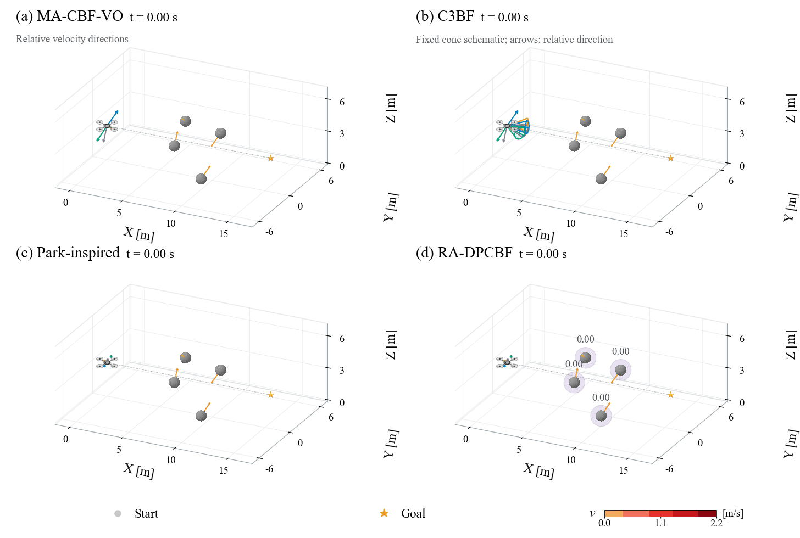 | 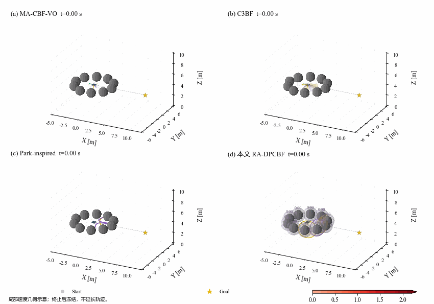 |
| 早期冻结典型案例；展示具体避障方式 | 条件绕行阶段的补充案例；保留各方法实际终止区间 |

<details>
<summary>展开查看百障碍密集场景</summary>

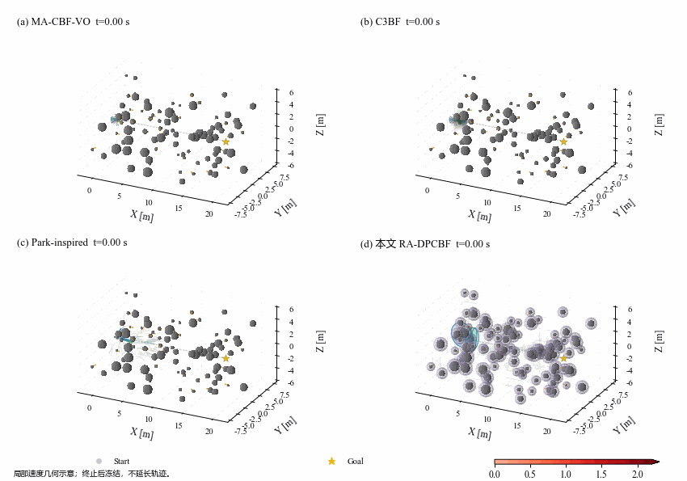

这是已保存的代表场景，不代替完整统计。动画中的方法名、坐标单位与原软件界面保持原样，中文图注解释其含义。

</details>

场景图中的抛物面或锥面是锚定到当前位置展示的**相对速度边界示意**，不是位置空间中的物理护盾；实体障碍与动态预留球分别表示。

## 抛物面的动态变化：公式参数示意

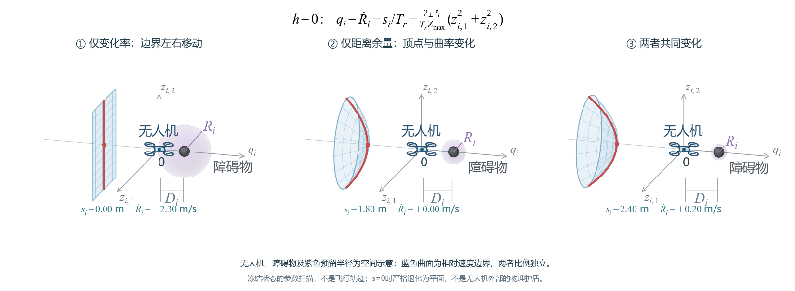

动画按冻结代码中的 $`h=0`$ 公式绘制；无人机、灰色障碍物和紫色预留半径用于解释几何关系。
① 半径变化率改变，边界左右平移；② 距离余量改变，顶点与曲率变化；③ 两者共同变化。
**s=0时仍严格画成平面。** 无人机与障碍物为空间示意，蓝色边界属于相对速度空间，比例独立；这是冻结状态参数扫描，不是新的飞行轨迹。
[绘图源码](reproducibility/render_dynamic_boundary.py) · [逐帧参数](numerical/data/抛物面动态变化_参数.csv)

## 方法怎样工作

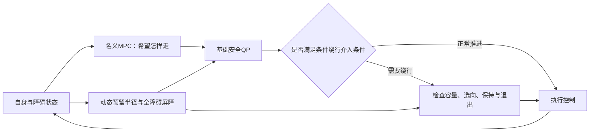

条件版介入检查包括共同安全余量不足、持续径向制动或停滞等条件，并需要阻挡对象与可执行方向。容量不足时保留基础安全输入；基础安全QP无解时按对应批次的停止策略处理。目标推进选向属于后期扩展，各批次仍按各自冻结实现解释。

### ① 安全边界怎么算

对第 $`j`$ 个障碍，定义相对位置、速度及其径向和横向分量：

```math
r_j=p_{o,j}-p,\quad w_j=v_{o,j}-v,\quad D_j=\|r_j\|,\quad e_j=r_j/D_j,
```
```math
q_j=e_j^\top w_j,\qquad z_j=(I-e_je_j^\top)w_j,\qquad s_j=D_j-R_j.
```

其中 $`p,v`$ 是自身位置、速度， $`p_{o,j},v_{o,j}`$ 是障碍位置、速度； $`D_j`$ 是中心距离， $`R_j`$ 是要求预留的中心距离， $`s_j`$ 是边界余量。

参考半径先由接近速度确定，再限幅、平滑。数值冻结代码实际使用

```math
c_j=\frac{\sqrt{q_j^2+\varepsilon_c^2}-q_j}{2},\qquad R_{0,j}=r_{\mathrm{robot}}+r_{o,j}+m_0,
```
```math
R_{\mathrm{des},j}=R_{0,j}+\tau_d c_j+\frac{c_j^2}{2a_{\mathrm{br}}}+m_{\mathrm{pred}},\qquad R_{\mathrm{ref},j}=\mathrm{clip}(R_{\mathrm{des},j},R_{0,j},R_{0,j}+\Delta R).
```

 $`c_j`$ 是平滑的接近速度， $`\tau_d c_j`$ 为反应距离， $`c_j^2/(2a_{\mathrm{br}})`$ 为设计制动距离。 $`m_0`$ 为基础预留， $`m_{\mathrm{pred}}`$ 为附加预测余量； $`\Delta R`$ 限制半径增量。数值版本取 $`\varepsilon_c=0.03\,\mathrm{m/s}`$ 、 $`a_{\mathrm{br}}=1.2\,\mathrm{m/s^2}`$ 、 $`m_0=0.15\,\mathrm m`$ 、 $`m_{\mathrm{pred}}=0`$ 。 $`a_{\mathrm{br}}`$ 是冻结的半径设计参数，不应默认等同于所有执行平台的有效控制能力。

实际半径通过二阶动态系统平滑变化，屏障同时考虑边界移动和横向运动：

```math
\ddot R_j=\omega_R^2(R_{\mathrm{ref},j}-R_j)-2\omega_R\dot R_j,
```
```math
\boxed{h_j=q_j-\dot R_j+\left(T_r^{-1}+\beta\|z_j\|^2\right)s_j.}
```

**当 $`s_j=0`$ 时， $`h_j=\dot s_j`$ 。** 也就是说，到达预留边界时，横向速度不能抵消正在穿过边界的危险。 $`T_r>0`$ 是时间尺度， $`\beta\ge0`$ 调节横向项， $`\omega_R>0`$ 调节半径响应速度。

正文与动图的系数关系为 $`\beta=\gamma_\perp/(T_rZ_{\max})`$ ； $`Z_j=\|z_j\|^2`$ ， $`Z_{\max}`$ 的单位为 $`\mathrm{m^2/s^2}`$ 。 $`q_j<0`$ 表示接近障碍； $`s_j`$ 是扣除动态预留后的余量，不能与实体间隙混用。[冻结公式实现](numerical/code/conditional_6000/current_method_conditional/dynamic_study/kernel.py)

对 $`\dot p=v,\ \dot v=u`$ ，屏障导数可写为 $`\dot h_j=A_j+B_j^\top u`$ ，其中 $`B_j=-e_j-2\beta s_jz_j`$ 。基础安全输入集合为

```math
K_{\mathrm{safe}}=\{u\in U:A_j+B_j^\top u+k_hh_j\ge\Delta_{h,j},\ \forall j\}.
```

 $`U`$ 是有限加速度输入范围， $`k_h>0`$ 是屏障反馈增益， $`\Delta_{h,j}`$ 是对应执行版本的预留量。数值与飞控阶段的预留方式分别由各自配置确定。

### ② 遇到堵塞怎么绕

选择与障碍连线垂直的单位方向 $`d_j`$ ，并定义沿此方向的相对绕行速度：

```math
d_j^\top e_j=0,\quad \|d_j\|=1,\qquad \chi_j=d_j^\top(v-v_{o,j})=-d_j^\top z_j.
```

方向随连线运输时，

```math
\dot\chi_j=d_j^\top(u-a_{o,j})-\frac{q_j}{D_j}\chi_j.
```

 $`a_{o,j}`$ 是障碍加速度。保留全部安全约束后，这个方向还能提出多强的要求，由方向容量衡量：

```math
\Gamma_j(d_j)=\max_{u\in K_{\mathrm{safe}}}\left[d_j^\top(u-a_{o,j})+\left(k_\perp-\frac{q_j}{D_j}\right)\chi_j\right],
```
```math
\Gamma_{\mathrm{exe},j}=\Gamma_j-\Delta_{\perp,j}.
```

只有容量满足相应版本的激活条件，才采用 $`\nu_j=\min\{\nu_{\mathrm{req}},\eta\Gamma_{\mathrm{exe},j}\}`$ ，并加入

```math
\dot\chi_j+k_\perp\chi_j\ge\nu_j+\Delta_{\perp,j},\qquad 0<\eta<1.
```

 $`k_\perp`$ 是横向反馈增益， $`\Delta_{\perp,j}`$ 是绕行采样预留， $`\nu_{\mathrm{req}}`$ 是请求强度。**容量不足就不强加绕行，不能通过撤销安全约束获得通路。**

后期版本还比较候选控制的短期目标推进 $`P(d)=\|p_g-p\|-\|p_g-\hat p_d(H)\|`$ ，并加入方向保持与退出。 $`p_g`$ 为目标， $`\hat p_d(H)`$ 为短期预测位置。它是局部评价，没有全局到达保证；6000次阶段与后期C03/PX4版本的选向逻辑须分别看待。

### ③ 这项研究主要贡献什么

- **核心方法：**构造与移动预留边界一致的三维屏障，并讨论有限输入下的条件安全和可行性。
- **配套算法：**在共同安全输入范围内组织条件绕行、方向容量检查、保持、重选和退出。
- **验证贡献：**区分理想控制可行、动力学跟踪、实际安全量和飞控执行时序，用四个阶段的真实记录检查。

使用抛物面、横向运动、MPC＋CBF-QP和切向绕行各有已有研究基础。这里不把二维升三维或组合现有工具单独宣称为首创。

## 6000次统计：完成率与控制干预分开看

1500个共享场景：5种障碍数量（1、10、30、50、100）×3种最大半径（0.3、0.5、0.7 m）×100个种子，每个场景比较4种方法。主统计障碍恒速。

| 方法 | 到达/1500 | 完成率 |
|---|---:|---:|
| RA-DPCBF（条件绕行版） | 1410 | 94.00% |
| Park适配 | 1375 | 91.67% |
| MA-CBF-VO | 1345 | 89.67% |
| C3BF | 865 | 57.67% |

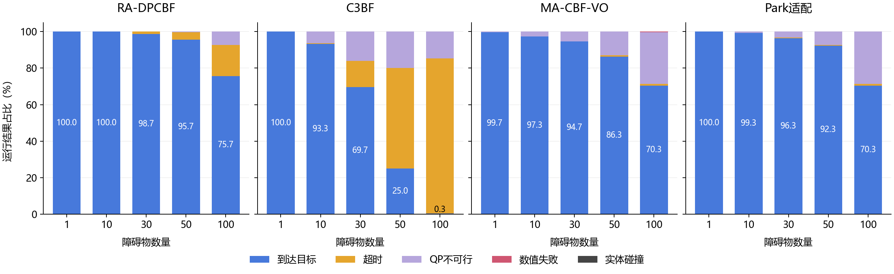

**到达、超时、QP不可行、数值失败分别统计。** 本表中无实体碰撞不意味着所有方法都完成任务，也不能单独证明全程屏障约束成立。场景生成的外层尝试预算曾经用户授权从1000增至10000；其余条件保持对应批次冻结值。

这些完成率是描述性统计，不由百分比差异直接推断显著优越。原保守单障碍选参推论未覆盖本批主实验初值，不能把6000次说成该推论指导选参后的验证；[适用范围与数值代入](reproducibility/理论覆盖范围.md)单独列明。

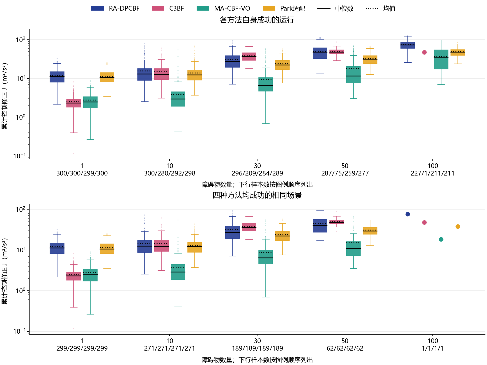

 $`J=\sum\Delta t\|u-u_{\mathrm{MPC}}\|^2`$ 表示累计偏离名义控制的程度，**不是CPU耗时，也不能单凭低值判断方法更好**。上图按各自成功样本，下图按四方法共同成功场景；样本数写在横轴下。100障碍共同成功只有1例，只画点。

[6000次中文逐次结果](numerical/data/6000次逐次结果_中文.csv) · [60单元汇总](numerical/data/60单元汇总.csv) · [原始字段表](numerical/data/formal_6000.csv)

## 绕行有没有用：用消融回答

| C03堵塞场景配置 | 结果 |
|---|---|
| 完整方法 | 19.09 s到达 |
| 关闭主动绕行 | 40 s超时 |
| 关闭后续重选 | 22.95 s到达 |

**三维轨迹对比**

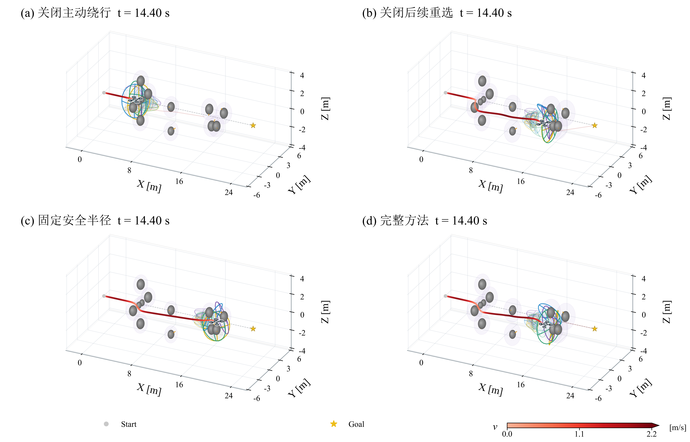

**到目标的距离变化**

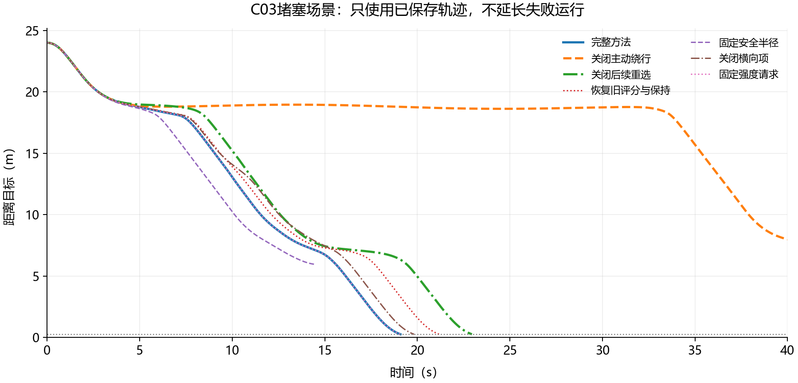

这是定向构造的12障碍瓶颈案例，说明绕行在这一工况中帮助通行，**不能代替普遍必要性的证明**。一般配对消融中，完整方法也有不如关闭绕行或固定半径的情况，详见[消融与局限](supplementary/README.md)。

| 证据类型 | 原结果 | 结论范围 |
|---|---|---|
| C03定向堵塞 | 完整19.09 s到达，关闭绕行40 s超时 | 支持这个瓶颈中的通行作用 |
| 一般60场景配对 | 完整57/60，关闭绕行58/60，固定半径60/60 | 未证明完整方法或绕行在普通场景普遍必要 |

## PyBullet：早期物理接入原型

早期通过四旋翼速度接口验证控制接入，保留9份位置轨迹与精选录像。它使用历史PD/HOCBF与软RA配置，不是后期MPC和硬安全QP的直接性能验证。[查看场景、录像与源码边界](pybullet/README.md)

## 四旋翼动力学能否跟上

| RotorPy：四方法共享场景 | RotorPy：RA十/五十障碍 |
|:---:|:---:|
| 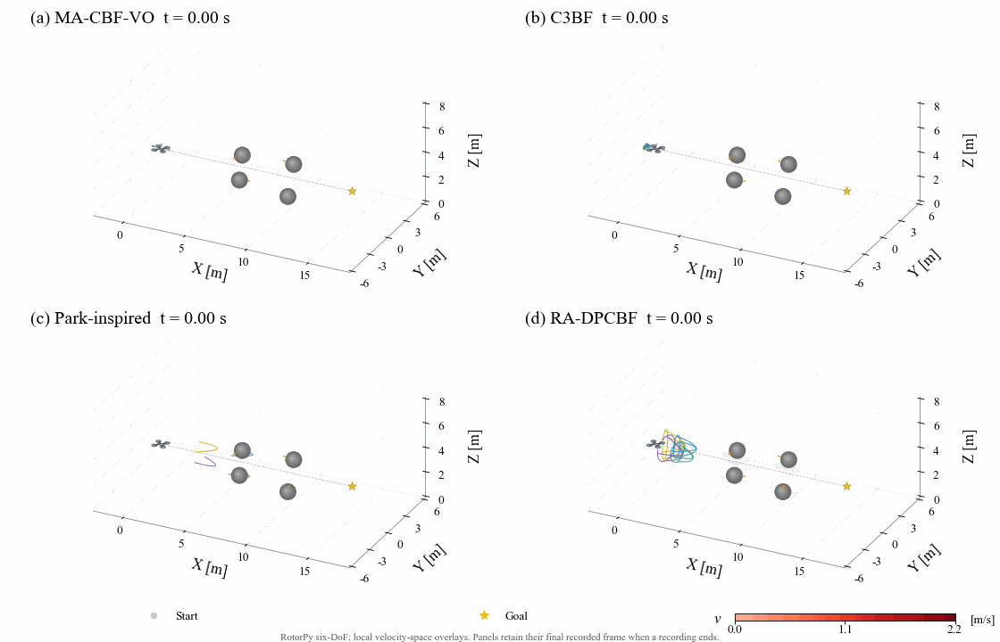 | 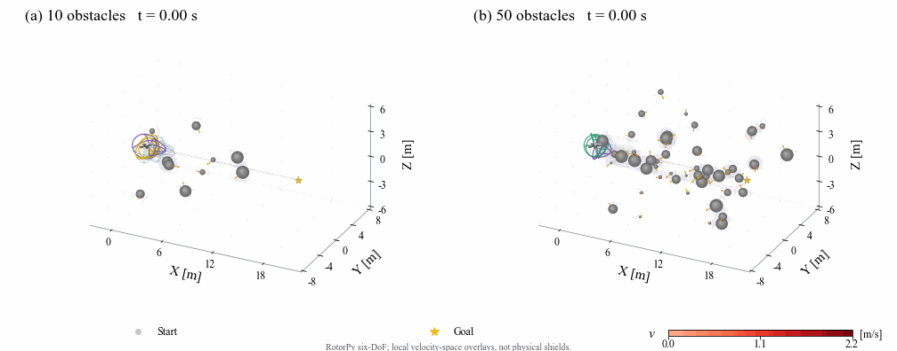 |

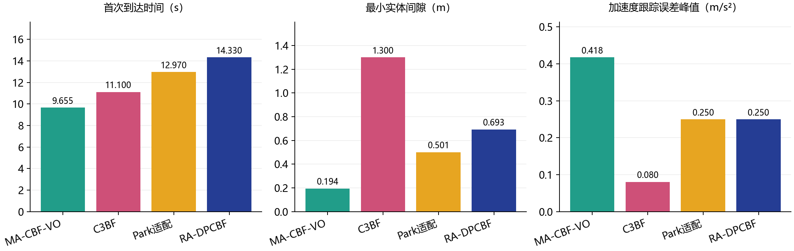

四障碍中RA首次到达14.330 s，长于MA的9.655 s，不能写成RA效率始终更高。C3BF虽然首次进入目标区域，但到达后两秒未稳定。右侧密集动画只有RA案例，不是四方法密集对比。

## PX4＋Gazebo：初版36次与独立四障碍大图

| 方法 | 运行次数 | 到达 | 第一版执行检查通过 |
|---|---:|---:|---:|
| RA-DPCBF | 9 | 8 | 8 |
| Park适配 | 9 | 4 | 3 |
| MA-CBF-VO | 9 | 8 | 0 |
| C3BF | 9 | 0 | 0 |

本表采用初版D82的统计口径；4障碍另属更早独立批次，不计入36次。按场景分组，每个方法单独全宽显示。

**“执行检查通过”采用该批次原接受口径，不代表严格20 ms硬实时保证；原批次仍有24 ms收令间隔记录。** 初版36次运行目录与冻结清单已找回并核对，当前公开的`runtime`仍是后期100次代码，不是这些原片的直接生成包。[结果—代码—配置对应表](reproducibility/版本与复现状态.md) · [初版90项源码配置校验索引](px4-gazebo/data/初版36次源码配置索引.csv)

大图跳转：[4障碍](#4障碍物四方法大图) · [10障碍](#10障碍物四方法大图) · [50障碍](#50障碍物四方法大图) · [100障碍](#100障碍物四方法大图)

### 4障碍物：四方法大图

来源：较早D65四障碍独立批次，不属于36次。

#### MA-CBF-VO


历史到达记录：是；较早执行口径，不与后期严格通过次数混算。

#### C3BF

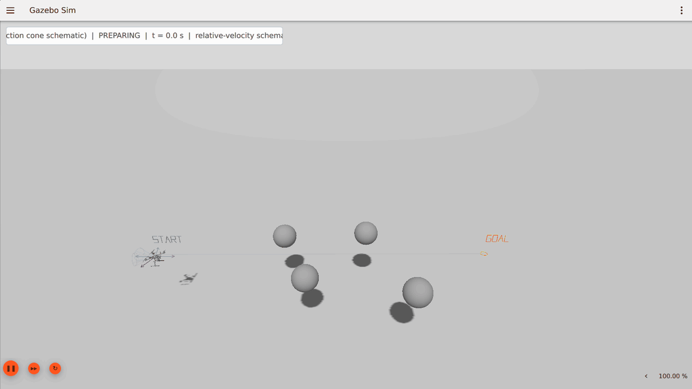

历史到达记录：否；较早执行口径，不与后期严格通过次数混算。

#### Park适配

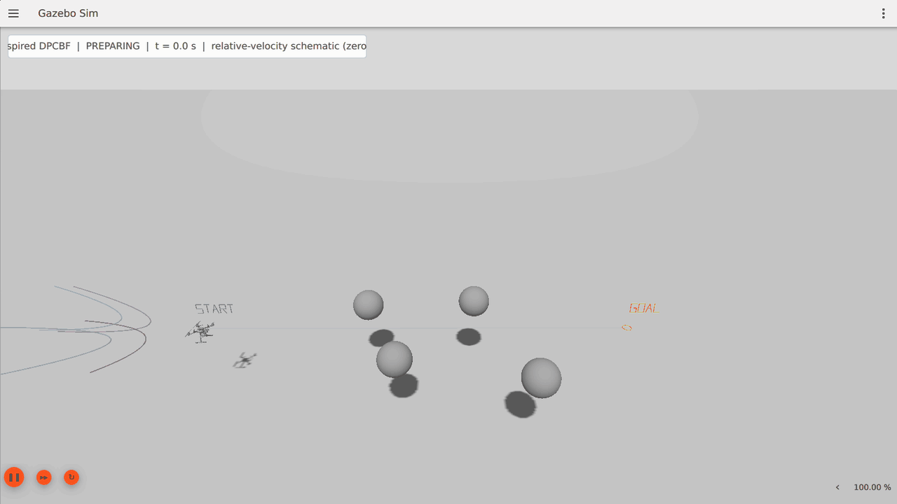

历史到达记录：是；较早执行口径，不与后期严格通过次数混算。

#### RA-DPCBF

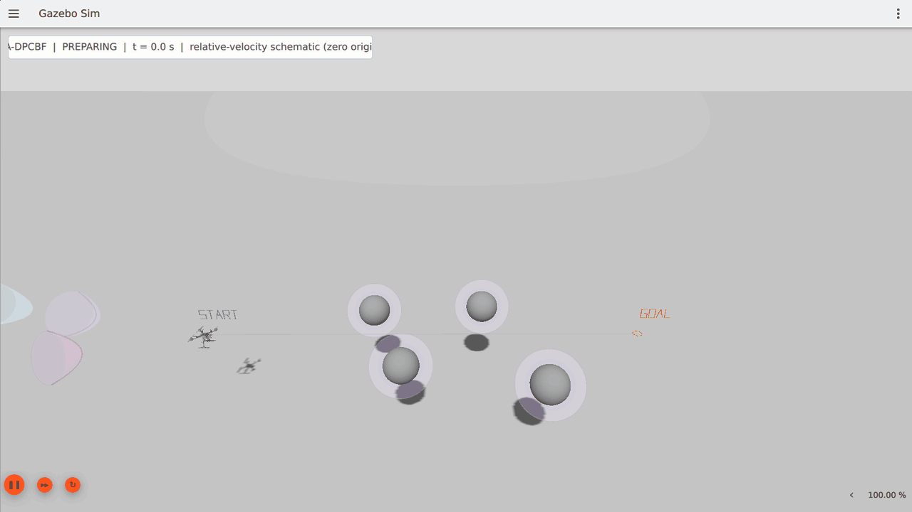

历史到达记录：是；较早执行口径，不与后期严格通过次数混算。


### 10障碍物：四方法大图

来源：D82第一版36次；原则上采用当时登记的代表片；十障碍MA首片有弹窗遮挡，改用同批次第2次原片，未采用D89后续批次。

#### MA-CBF-VO

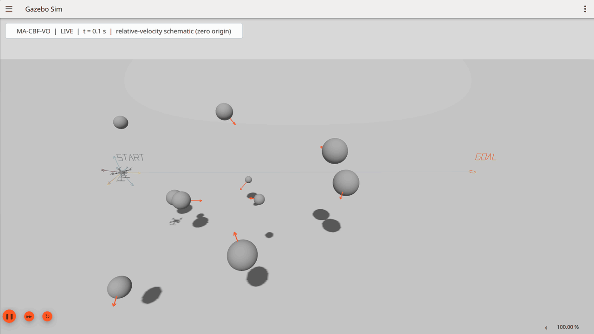

到达：**是**；第一版执行检查：**未通过**。

#### C3BF

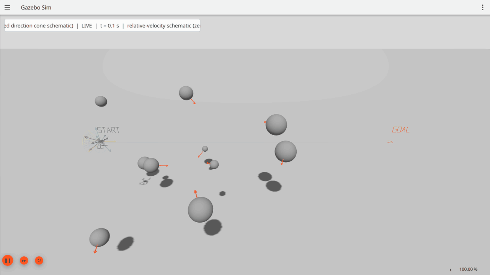

到达：**否**；第一版执行检查：**未通过**。

#### Park适配

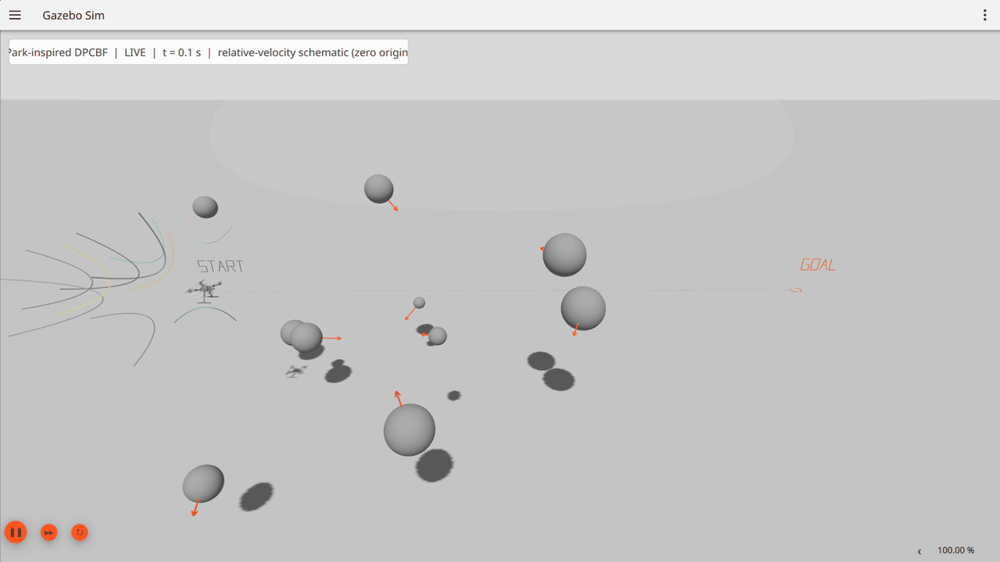

到达：**是**；第一版执行检查：**通过**。

#### RA-DPCBF

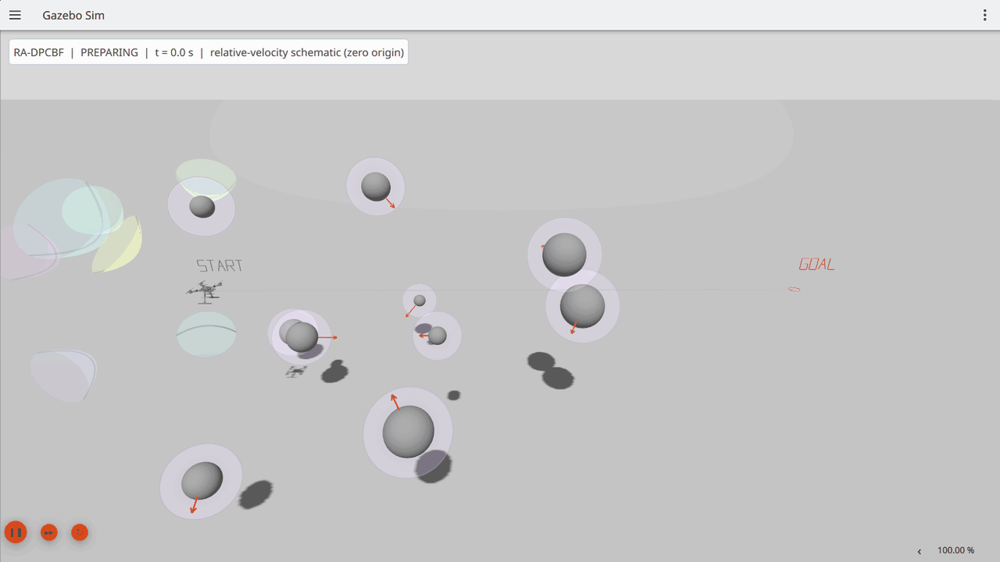

到达：**是**；第一版执行检查：**通过**。


### 50障碍物：四方法大图

来源：D82初版36次登记代表片；保留原停止区间与检查结果。

#### MA-CBF-VO

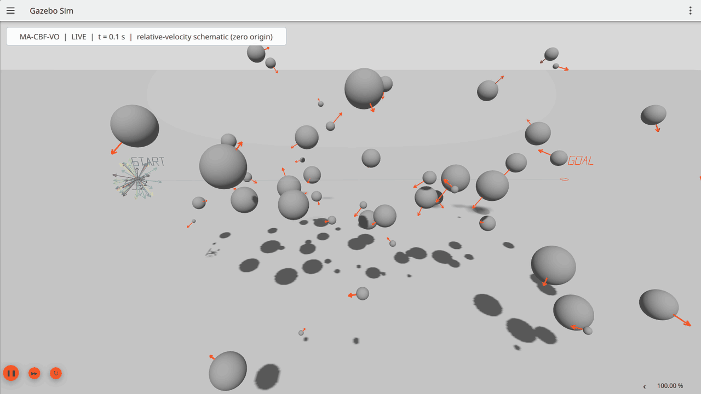

到达：**是**；第一版执行检查：**未通过**。

#### C3BF

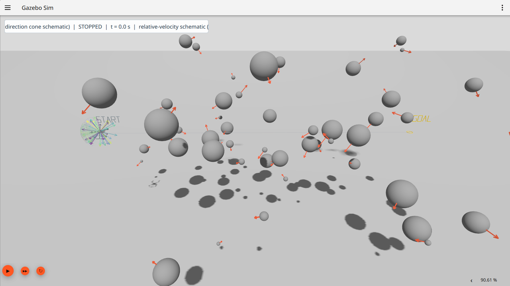

到达：**否**；第一版执行检查：**未通过**。 **原件为早停截图，没有导航录像。**

#### Park适配

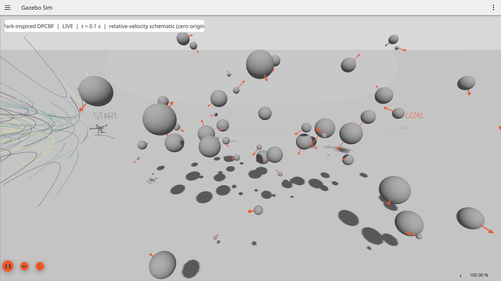

到达：**否**；第一版执行检查：**未通过**。

#### RA-DPCBF

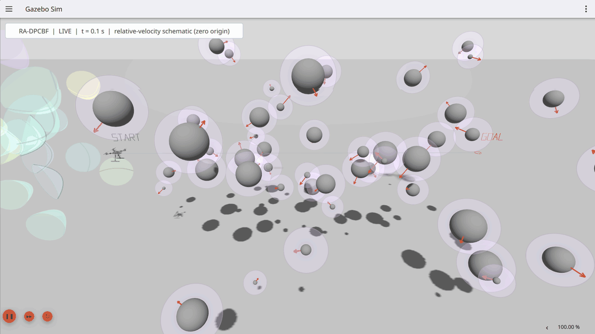

到达：**是**；第一版执行检查：**通过**。


### 100障碍物：四方法大图

来源：D82初版36次登记代表片；保留原停止区间与检查结果。

#### MA-CBF-VO

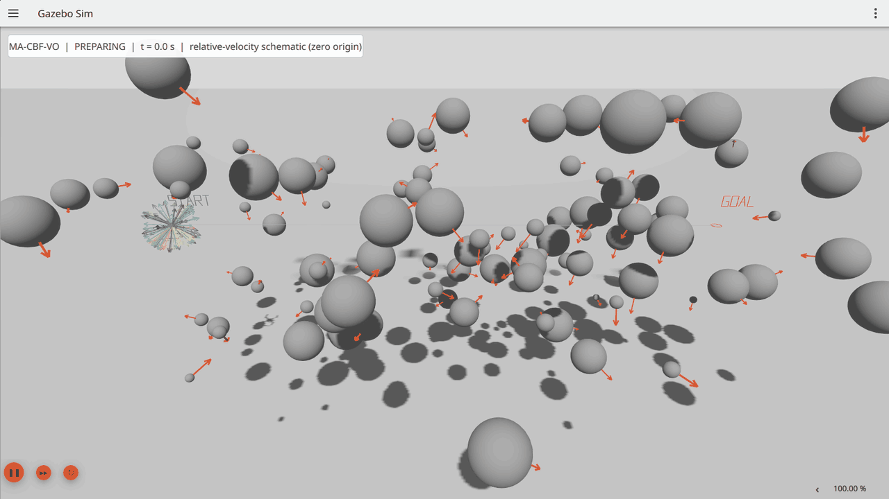

到达：**是**；第一版执行检查：**未通过**。

#### C3BF

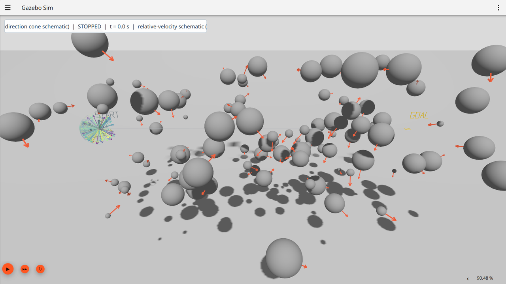

到达：**否**；第一版执行检查：**未通过**。 **原件为早停截图，没有导航录像。**

#### Park适配

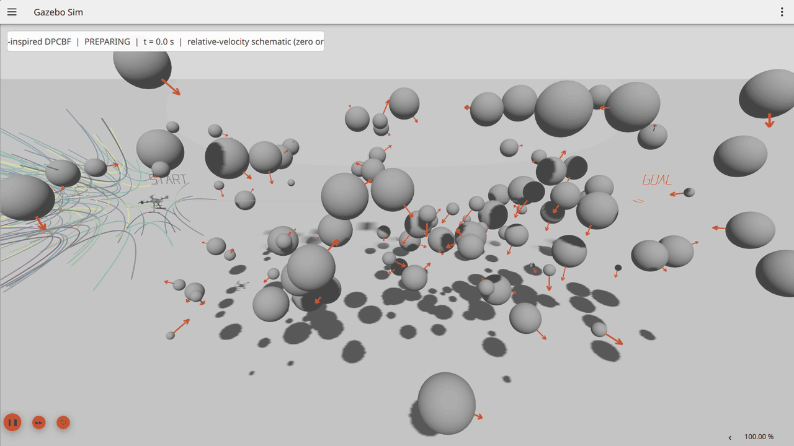

到达：**否**；第一版执行检查：**未通过**。

#### RA-DPCBF

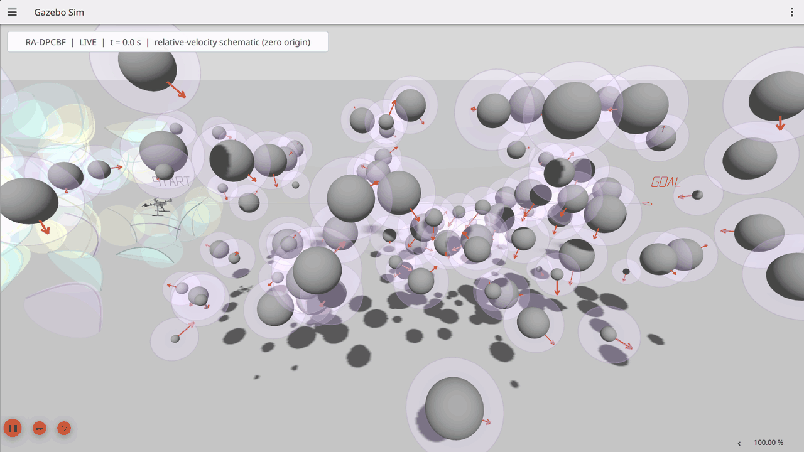

到达：**是**；第一版执行检查：**通过**。

[第一版大图专页与来源说明](px4-gazebo/精选16格对比.md) · [后续100次仅作归档入口](px4-gazebo/全部100次录像.md)

## 查看数据与复现

只核对结果、重新画图，不需要启动仿真：

```bash
cd 3d-ra-dpcbf
python reproducibility/verify_release.py
python reproducibility/render_results.py
```

绘图需要NumPy、Matplotlib和中文字体；详细版本、各阶段入口、源码与结果的绑定关系见[复现说明](reproducibility/README.md)。本次发布只整理已有结果并离线复核，没有重新运行6000次或飞控实验。

## 参考与致谢

- [Park等：动态抛物线控制障碍函数及参考展示方式](https://github.com/tkkim-robot/safe_control/tree/main/dynamic_env)。本项目Park基线为三维适配。
- [gym-pybullet-drones](https://github.com/utiasDSL/gym-pybullet-drones)：早期四旋翼物理环境。
- [RotorPy](https://github.com/spencerfolk/rotorpy)：六自由度与电机动态环境。
- [PX4](https://github.com/PX4/PX4-Autopilot) 与 [Gazebo](https://gazebosim.org/)：飞控软件在环与物理环境。

上游源码与依赖保留各自许可。更完整的来源边界见[第三方说明](reproducibility/第三方说明.md)。
