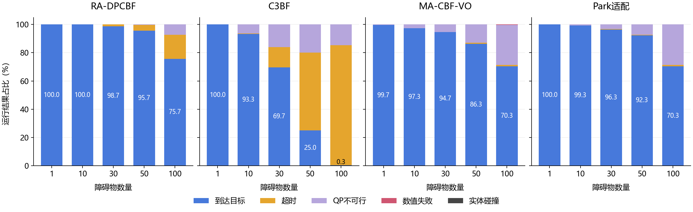
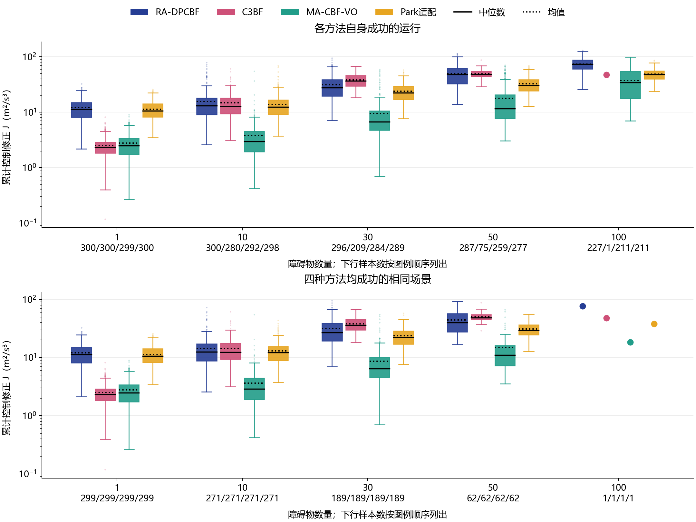
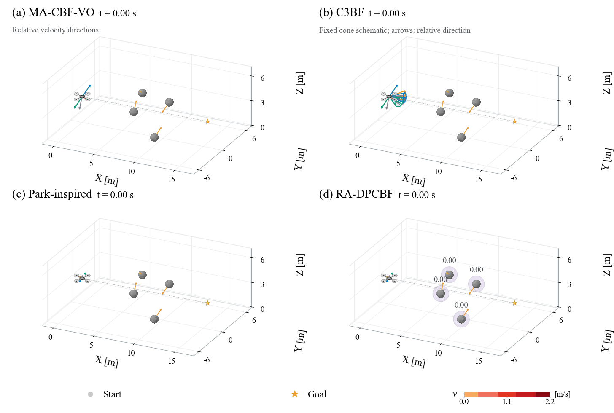
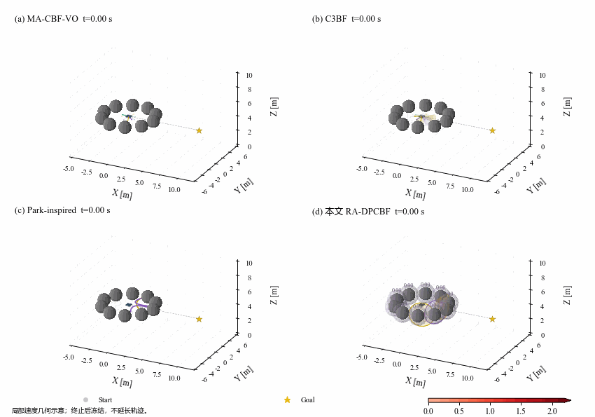
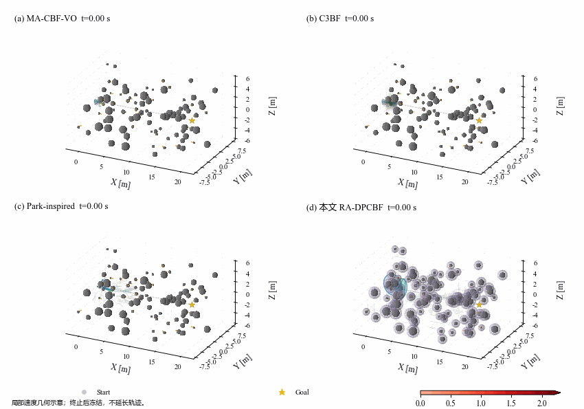
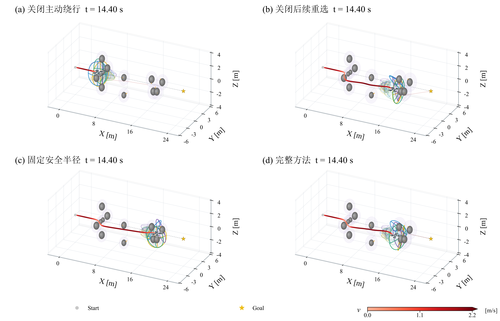
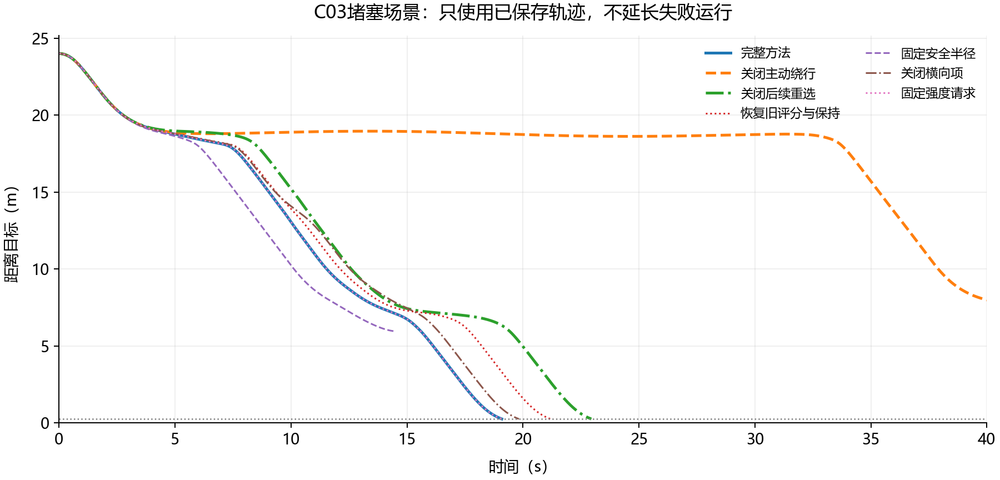

# ① Python数值实验

[返回总览](../README.md) · [消融与补充测试](../supplementary/README.md)

## 统计实验怎么做

- 1500个共享场景，每个场景比较RA-DPCBF、Park三维适配、MA-CBF-VO和C3BF，共6000条正式记录。
- 障碍数量为1、10、30、50、100，最大障碍半径为0.3、0.5、0.7 m；每组合100个种子。主统计障碍恒速。
- 使用对应批次的共同名义控制和约束条件。生成预算曾从1000提高到10000；只改变外层尝试预算，保留原接受场景与结果。
- 条件绕行RA替换旧RA，三种基线复用。不能将两种RA版本说成两批完全独立的6000次。

箱体为25%—75%，须为1.5倍四分位距，保留离群点；实线中位数、虚线均值。累计干预量只在成功样本中讨论，并另列共同成功场景。执行路径分层的CPU计时不与此量混用。

## 代表场景

| 四障碍动态交会 | 十障碍包围 |
|:---:|:---:|
|  |  |

四障碍动画来自早期冻结案例；包围和百障碍来自后续补充案例。它们解释具体行为，不能代替6000次总体统计，也不冒称都属于同一批随机统计样本。

## C03：为什么加绕行

原记录完整方法19.09 s到达，关闭绕行40 s超时，关闭重选22.95 s到达。轨迹按保存的时间终止，不延长、平滑或重跑。C03为12障碍定向瓶颈，观察窗40 s，到达半径0.25 m；不能与24 s统计批次直接合并成功率。

## 数据与源码

| 内容 | 入口 |
|---|---|
| 6000次中文逐次表 | [CSV](data/6000次逐次结果_中文.csv) |
| 60个数量/尺寸/方法单元 | [CSV](data/60单元汇总.csv) |
| 6000次原始机器字段 | [CSV](data/formal_6000.csv) |
| C03七组消融 | [CSV](data/C03七组机制消融.csv) |
| 条件绕行阶段核心与场景生成 | [源码](code/conditional_6000/) |
| 后期C03选向与方向保持 | [源码](code/c03/) |
| 三维典型图与曲线的紧凑原记录 | [数据](data/c03/) |

`conditional_6000`与`c03`分别保存各自公式实现。后者包含目标推进与保持设计，不能拿它替代前者的统计版本。便携单例入口为`python run_example.py --help`；默认只显示说明，只有显式传入`--run`才运行。原批处理调度器、自动重启和恢复脚本没有发布。
