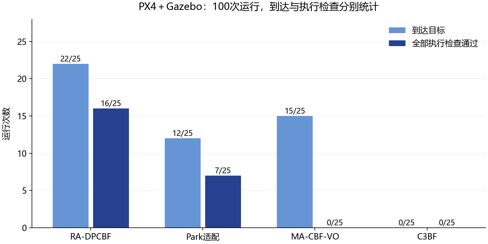

# ④ PX4＋Gazebo：飞控闭环验证

[返回总览](../README.md)

**[查看全部100次录像与逐项结果：81个动图＋19张停止截图](全部100次录像.md)**

这是Gazebo中运行PX4的**软件在环仿真**，不是实飞。控制器使用飞控状态反馈，轨迹和实际加速度由仿真物理状态独立核对。到达、跟踪、安全残差和收令时序分别检查。

| 方法 | 到达/25 | 全部执行检查通过/25 |
|---|---:|---:|
| RA-DPCBF | 22 | 16 |
| Park适配 | 12 | 7 |
| MA-CBF-VO | 15 | 0 |
| C3BF | 0 | 0 |

原36次与新增64次组成主100次，包含重复运行；10、50、100障碍每种方法分别8、8、9次。通过检查不表示全局安全、任意条件下可行或硬实时。

## 4、10、50、100障碍：16格精选

[打开16格内嵌动图对比](精选16格对比.md)

每种密度仅选一个共享场景，四方法并列；原始100次媒体仍由顶部总目录进入。

## 完整结果与源码

- [100次中文汇总](data/100次中文汇总.csv)；[100次逐项结果](data/全部100次可追溯记录.csv)。
- [精选录像及SHA256](data/精选录像索引.csv)；[全部100次媒体来源索引](data/100次媒体来源索引.csv)。全部100份原媒体现已发布，可从[100次录像总目录](全部100次录像.md)逐项打开。
- 真正运行入口：[runtime/code/run_continuous.py](runtime/code/run_continuous.py)，对应控制器为[px4_controller.py](runtime/code/px4_controller.py)。保留静态导入依赖、原生显示插件、配置与三个代表场景。
- [固件执行适配来源](firmware_overlay/)与[复现限制](../reproducibility/README.md)。100次媒体和逐次结果均可下载；没有上传可执行二进制、整个PX4框架或旧自动调度。

本次只在Windows离线核对源码、表和媒体。Linux SITL环境、原固件编译与完整100次重运行**没有在本次发布中重新验证**。请先阅读复现限制，不能把直接运行入口当作环境已配置完成。
