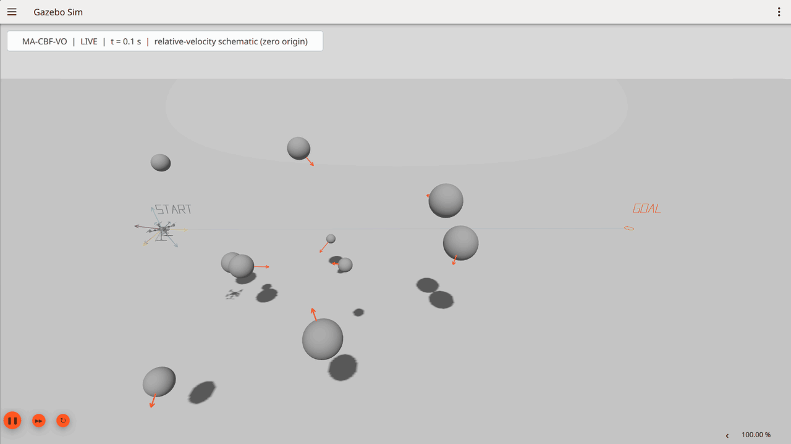
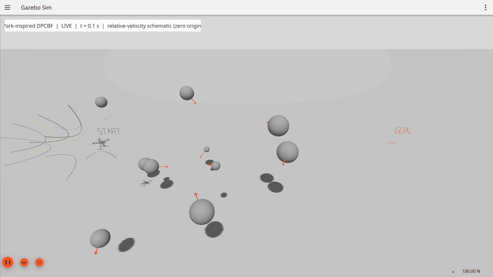
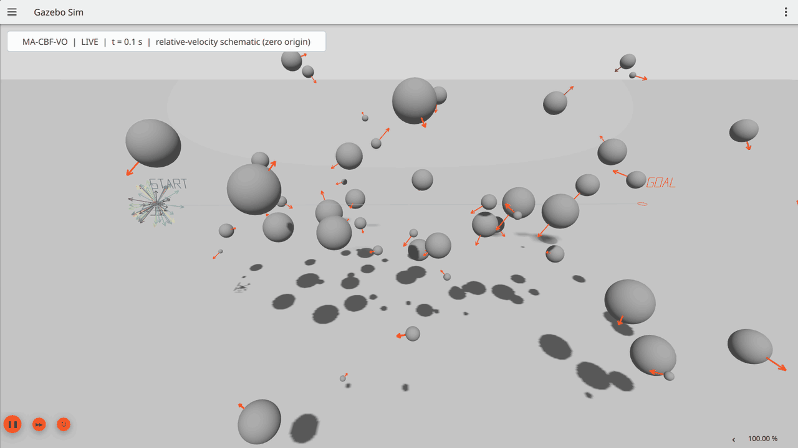
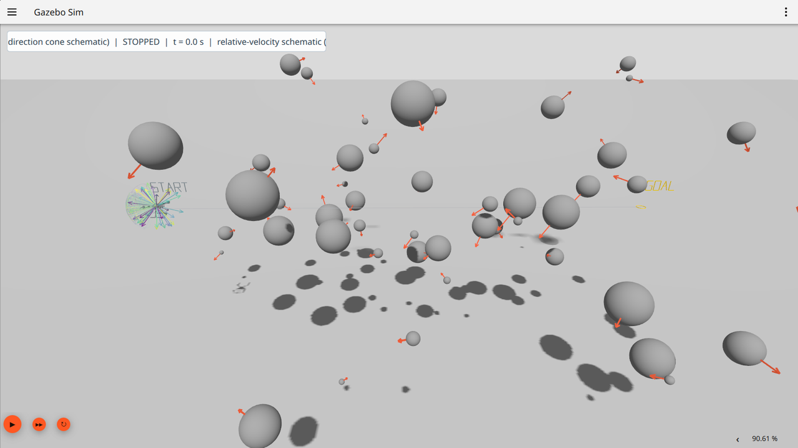
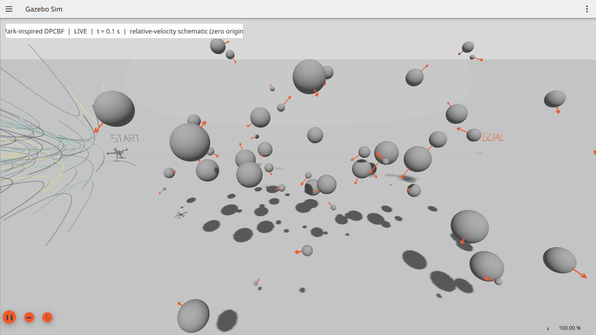
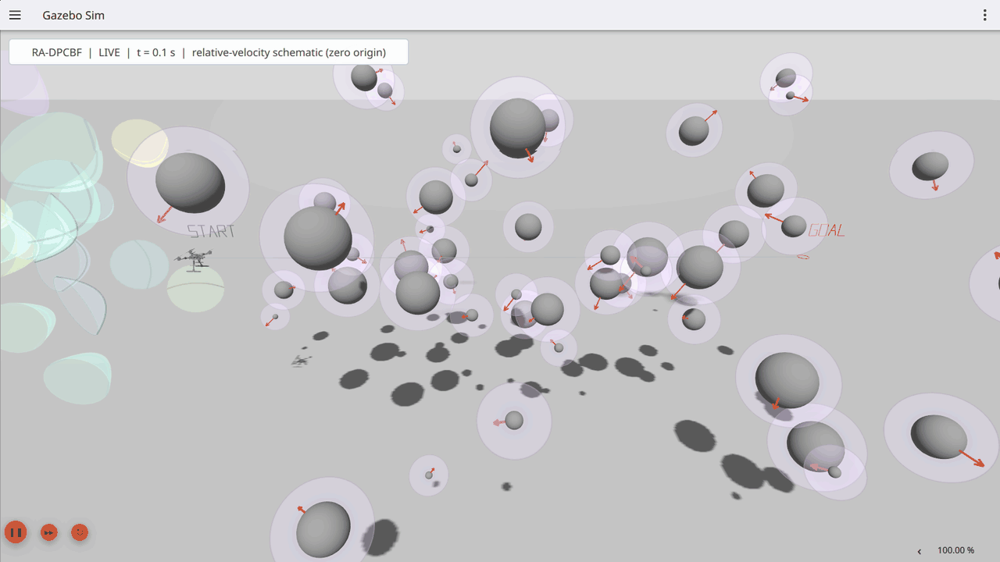
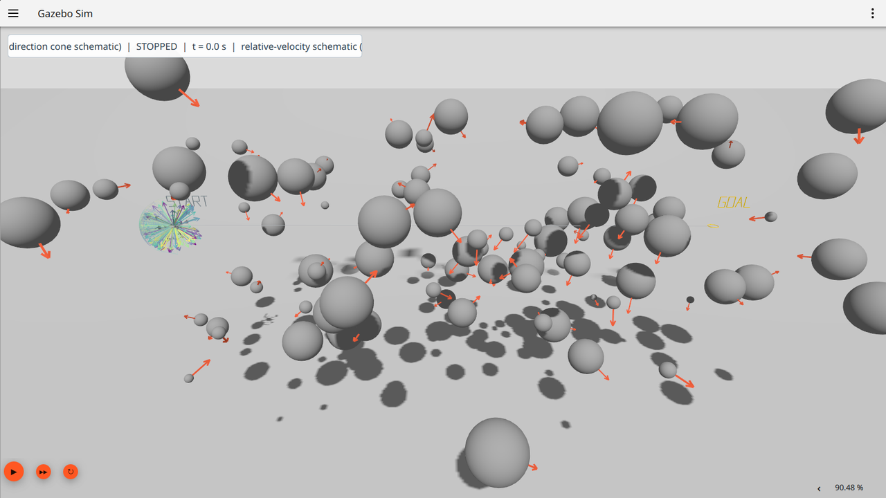
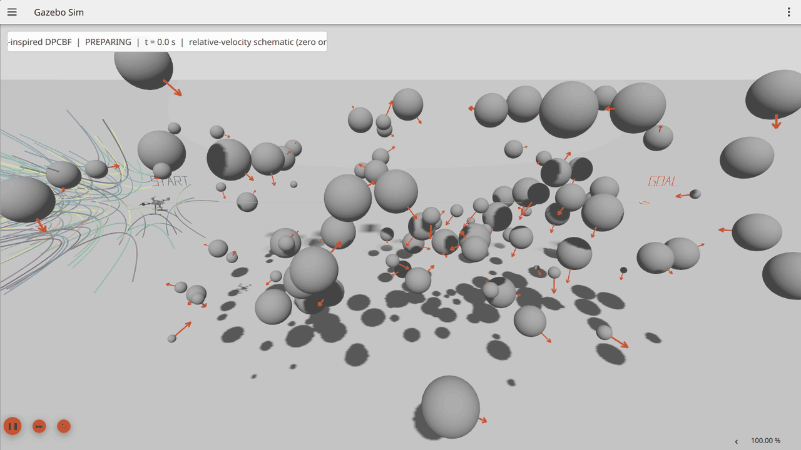

# 第一版PX4展示：4种情况 × 4种方法（大图）

[返回研究首页](../README.md) · [第一版36次分组结果](data/第一版36次分组结果.csv) · [第一版36次逐项原表](data/第一版36次逐项原表.csv) · [16项来源与SHA](data/16格精选展示索引.csv)

本页的10、50、100障碍代表素材来自第一版D82。该批四种方法各在三个场景重复3次，共36次。4障碍素材来自更早的D65独立对比，另列展示。D83/D89的后续100次素材见[完整归档](全部100次录像.md)。

选片只考虑同批次与画面可读性；十障碍MA首片有保存对话框遮挡，改用同批次第2次原片，其他沿用登记代表片。

快速定位：[4障碍](#4障碍物四方法大图) · [10障碍](#10障碍物四方法大图) · [50障碍](#50障碍物四方法大图) · [100障碍](#100障碍物四方法大图)

每个方法单独一张全宽大图，不再把16项缩成小格。共14个GIF与2张真实早停截图。保留失败，不延长短时停止，不重跑。第一版的执行通过不是硬实时保证，原批次仍记录过24 ms收令间隔。

D82原片对应[first36独立运行包](first36/README.md)和[90项源码配置索引](data/初版36次源码配置索引.csv)。`runtime`对应后期100次。各批次的原片、统计与代码见[版本对应表](../reproducibility/版本与复现状态.md)。

### 4障碍物：四方法大图

来源：较早D65四障碍独立批次，不属于36次。

#### MA-CBF-VO

历史到达记录：是；较早执行口径，不与后期严格通过次数混算。

#### C3BF

历史到达记录：否；较早执行口径，不与后期严格通过次数混算。

#### Park适配

历史到达记录：是；较早执行口径，不与后期严格通过次数混算。

#### RA-DPCBF

历史到达记录：是；较早执行口径，不与后期严格通过次数混算。

### 10障碍物：四方法大图

来源：D82第一版36次；原则上采用当时登记的代表片；十障碍MA首片有弹窗遮挡，改用同批次第2次原片，未采用D89后续批次。

#### MA-CBF-VO

到达：**是**；第一版执行检查：**未通过**。

#### C3BF

到达：**否**；第一版执行检查：**未通过**。

#### Park适配

到达：**是**；第一版执行检查：**通过**。

#### RA-DPCBF

到达：**是**；第一版执行检查：**通过**。

### 50障碍物：四方法大图

来源：D82初版36次登记代表片；保留原停止区间与检查结果。

#### MA-CBF-VO

到达：**是**；第一版执行检查：**未通过**。

#### C3BF

到达：**否**；第一版执行检查：**未通过**。 **原件为早停截图，没有导航录像。**

#### Park适配

到达：**否**；第一版执行检查：**未通过**。

#### RA-DPCBF

到达：**是**；第一版执行检查：**通过**。

### 100障碍物：四方法大图

来源：D82初版36次登记代表片；保留原停止区间与检查结果。

#### MA-CBF-VO

到达：**是**；第一版执行检查：**未通过**。

#### C3BF

到达：**否**；第一版执行检查：**未通过**。 **原件为早停截图，没有导航录像。**

#### Park适配

到达：**否**；第一版执行检查：**未通过**。

#### RA-DPCBF

到达：**是**；第一版执行检查：**通过**。
