# PX4精选展示：4种障碍数量 × 4种方法

[返回研究首页](../README.md) · [全部100次原始媒体](全部100次录像.md) · [16格来源与SHA](data/16格精选展示索引.csv)

每种障碍数量只展示一个共享场景中的四种方法，共16个展示位。**14个原生GIF和2张停止截图**；50、100障碍的C3BF档案未找到完整动图，保留真实早停截图，不拼造成功片段。

选择先限制为同批次共享场景，再按四方法原片帧数的 `Σlog(1+帧数)` 选择覆盖较完整的一组；不按RA成功、最短到达时间或最大间隙挑选。画面仅用于展示，完整统计和失败仍保留。各次实际接管状态不保证逐位相同。

4障碍来自较早D65飞控版本，10/50/100来自D89主100次，不能把16格当同版本的性能比较。没有启动新仿真。四障碍C3BF触发地面碰撞包络检查，这是原终止原因，不能仅凭该标签断言发生实体接触。

### 4障碍物：四方法对比

四障碍为较早D65原生录像，不与D89主100次合并统计。

| MA-CBF-VO | C3BF |
|:---:|:---:|
|  | 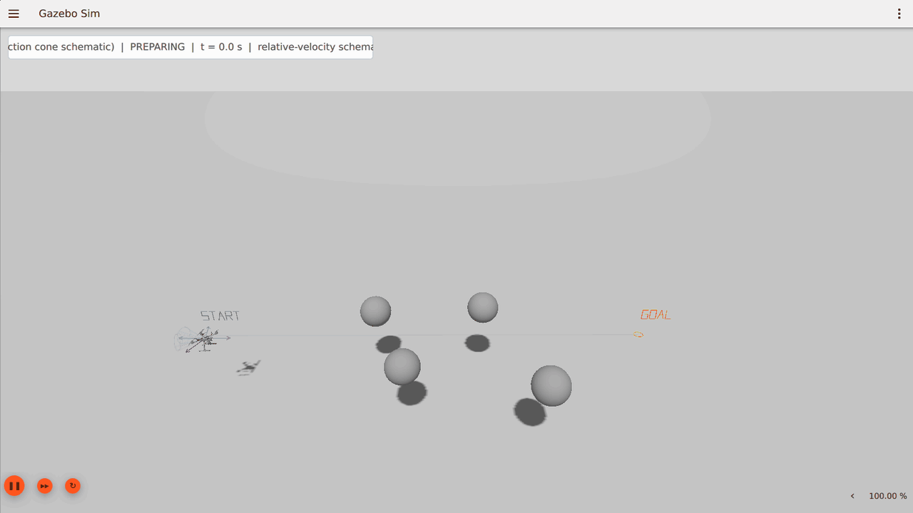 |
| 历史记录：到达 | 历史记录：触发地面碰撞包络检查，未到达 |

| Park适配 | RA-DPCBF |
|:---:|:---:|
| 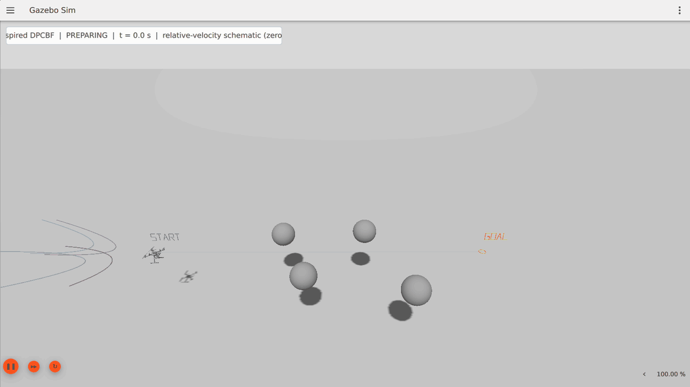 | 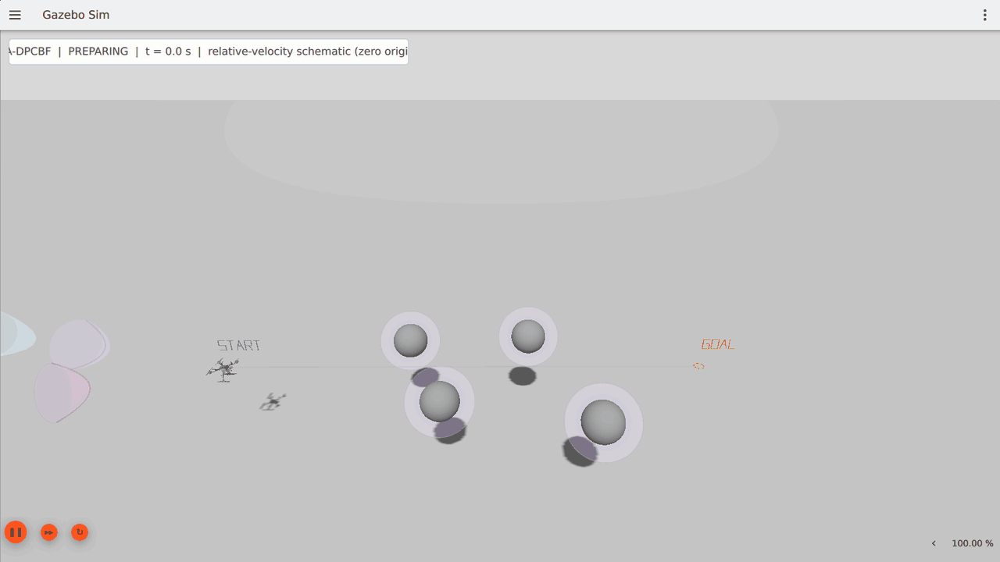 |
| 历史记录：到达 | 历史记录：到达 |

### 10障碍物：四方法对比

共享场景：`n010_s611004`。

| MA-CBF-VO | C3BF |
|:---:|:---:|
| 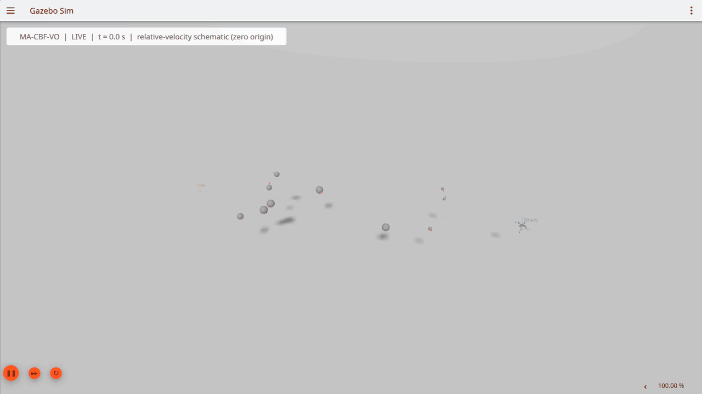 |  |
| 到达：是；执行检查：未通过 | 到达：否；执行检查：未通过 |

| Park适配 | RA-DPCBF |
|:---:|:---:|
| 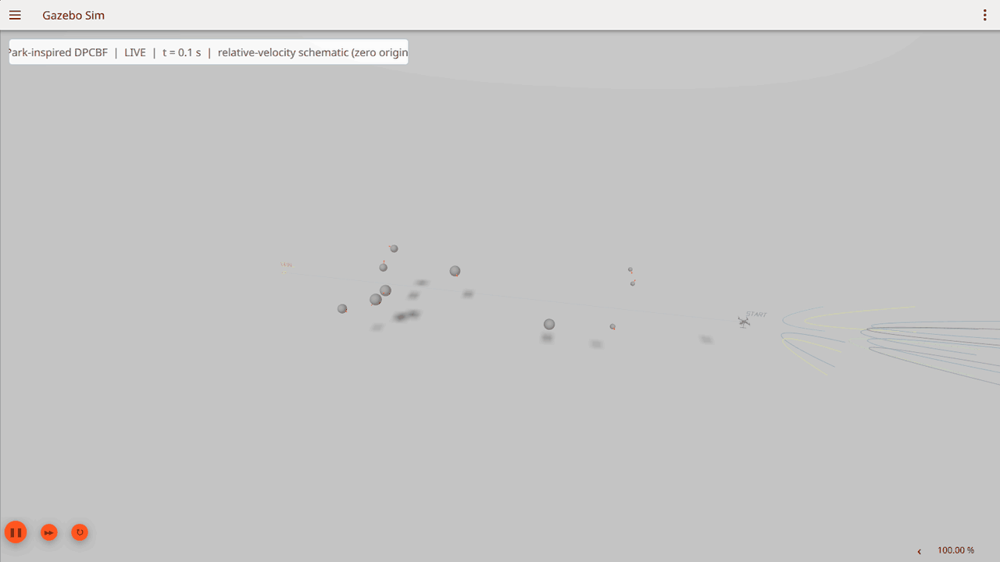 | 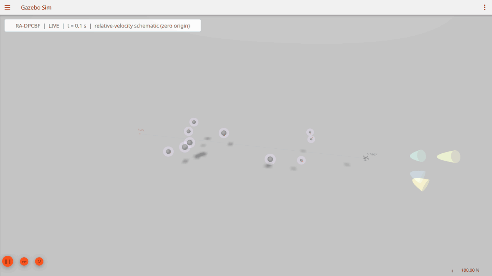 |
| 到达：是；执行检查：通过 | 到达：是；执行检查：通过 |

### 50障碍物：四方法对比

共享场景：`n050_s611006`。

| MA-CBF-VO | C3BF |
|:---:|:---:|
| 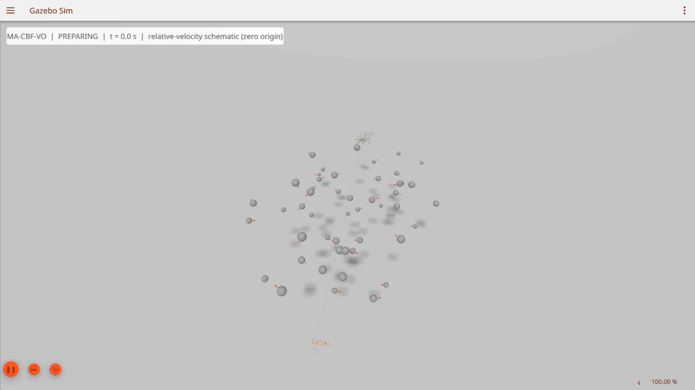 | 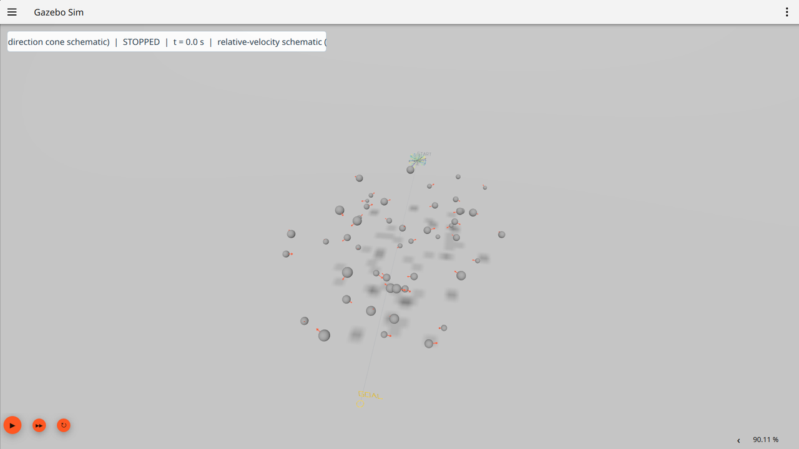 |
| 到达：是；执行检查：未通过 | 到达：否；执行检查：未通过；**原件仅停止截图** |

| Park适配 | RA-DPCBF |
|:---:|:---:|
| 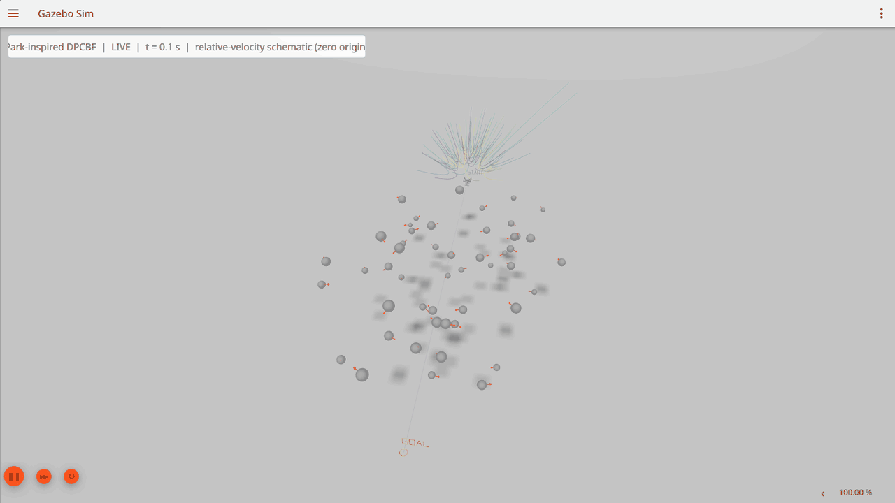 | 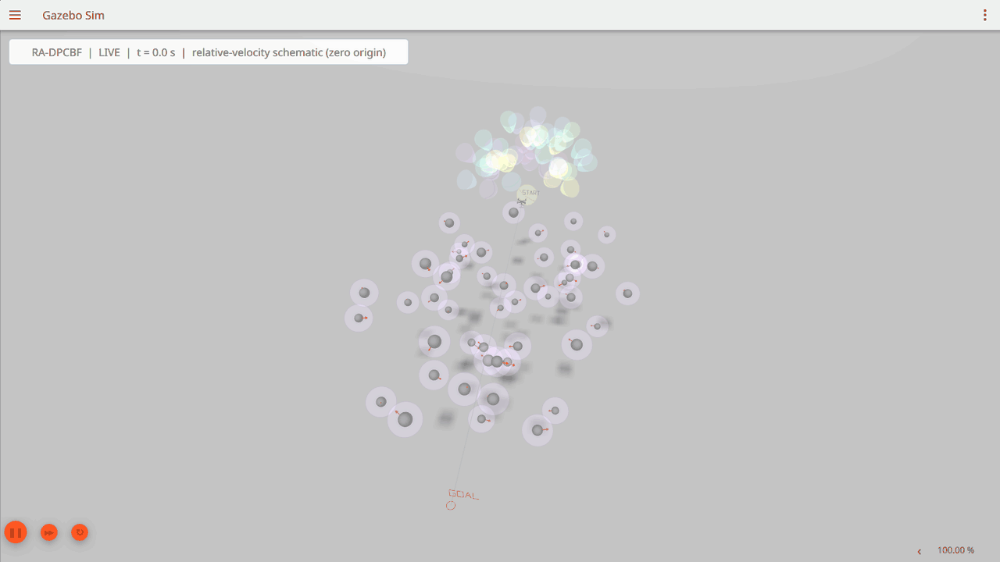 |
| 到达：否；执行检查：未通过 | 到达：是；执行检查：通过 |

### 100障碍物：四方法对比

共享场景：`n100_s611013`。

| MA-CBF-VO | C3BF |
|:---:|:---:|
| 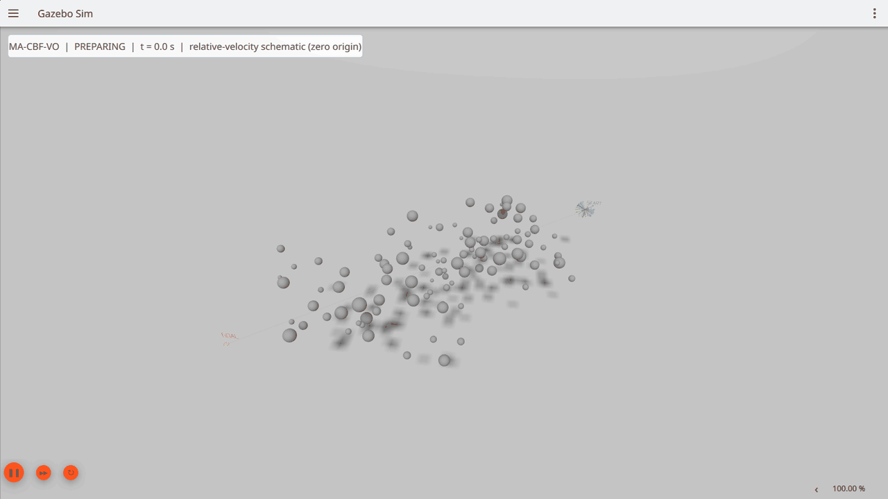 | 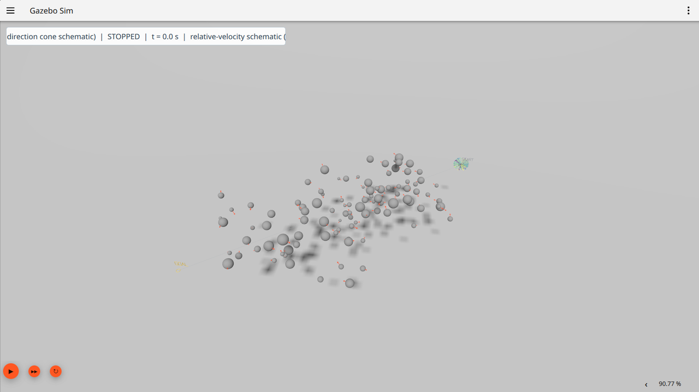 |
| 到达：否；执行检查：未通过 | 到达：否；执行检查：未通过；**原件仅停止截图** |

| Park适配 | RA-DPCBF |
|:---:|:---:|
| 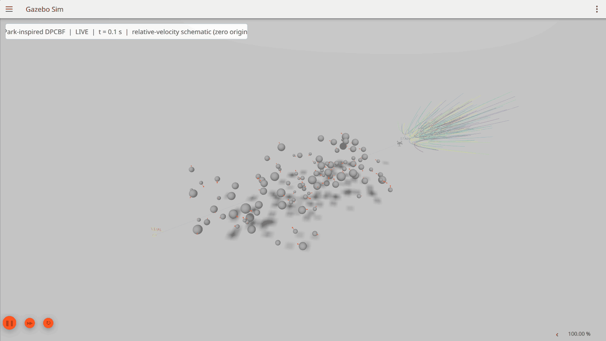 | 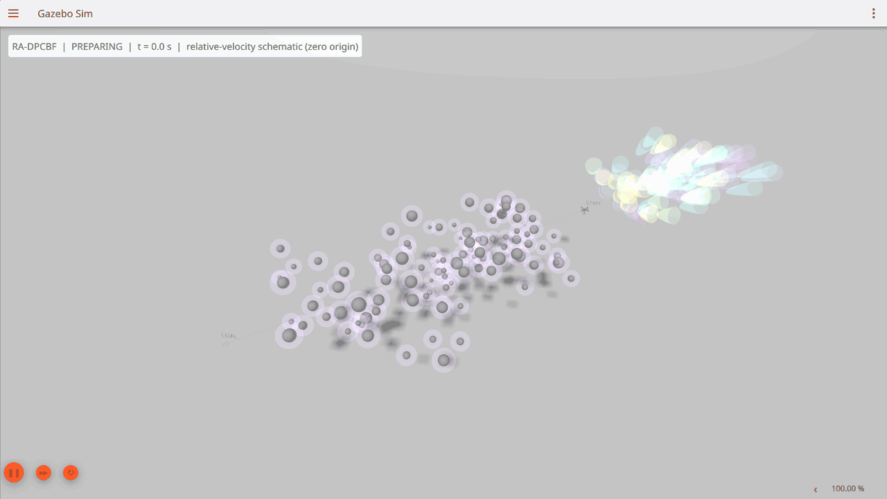 |
| 到达：是；执行检查：未通过 | 到达：是；执行检查：未通过 |
