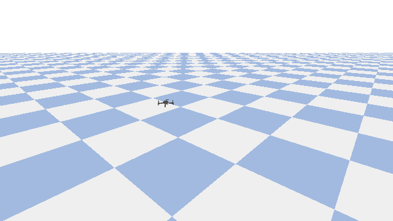

# ② PyBullet：早期四旋翼物理验证

[返回总览](../README.md)

这是研究早期的接入原型：CF2X四旋翼、240 Hz物理更新、48 Hz控制，通过`VelocityAviary`速度接口接入。名义PD、HOCBF与软RA实现均属于这一历史版本，**不是后期MPC与硬安全QP的直接性能验证**。

| 静态障碍 | 垂直运动障碍 |
|:---:|:---:|
|  |  |
| [原MP4](media/静态障碍.mp4) | [原MP4](media/垂直运动障碍.mp4) |

## 保留哪些内容

- [控制与场景源码](code/gym_pybullet_drones/examples/ra_dpcbf/)；[安全滤波和执行适配](code/gym_pybullet_drones/safety/)。
- [9份轨迹](data/)覆盖目标跟踪、静态场景、名义/基线/RA、横穿、垂直、迎面、斜向运动，不能算成9次独立RA成功实验。
- 7个历史案例原有视频；本仓库只精选2组。迎面与斜向案例目前只发现轨迹。
- 轨迹仅保存位置，不能仅凭它复算全部屏障残差或证明执行约束。

## 使用代码

这是对`gym-pybullet-drones`的扩展层，未重复上传整个框架。先按[上游项目](https://github.com/utiasDSL/gym-pybullet-drones)安装环境，再将`code/gym_pybullet_drones/`中的新增模块合入独立副本。`upstream/pyproject.toml`保留原依赖。迁盘后的工作树Git指针仍指向旧盘，未能仅凭该指针确认原上游提交；因此本版不宣称已在新环境复现。
