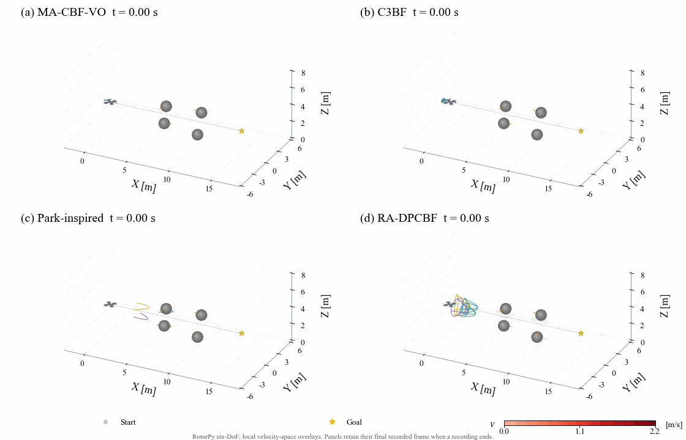
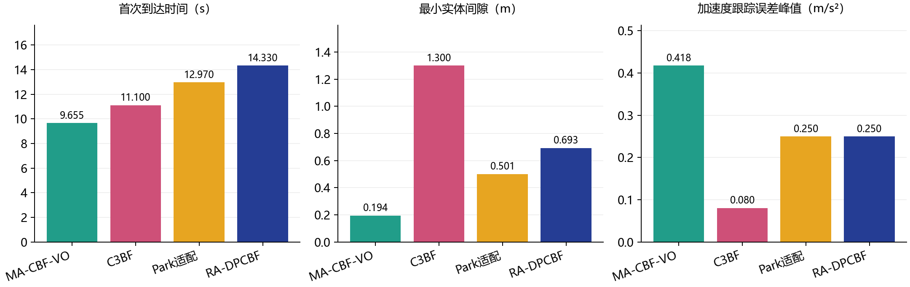
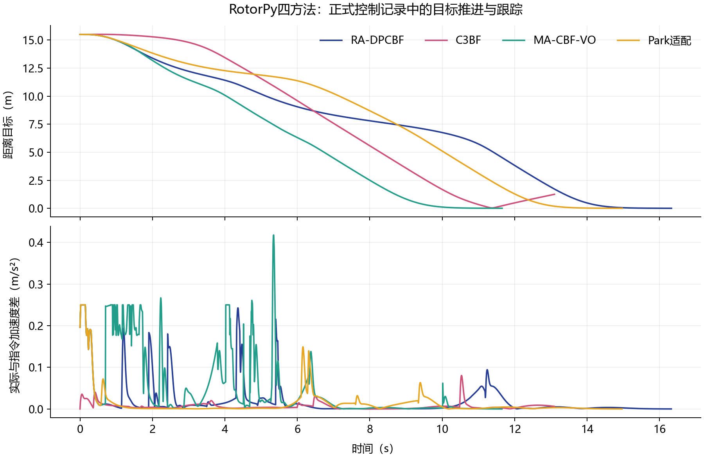
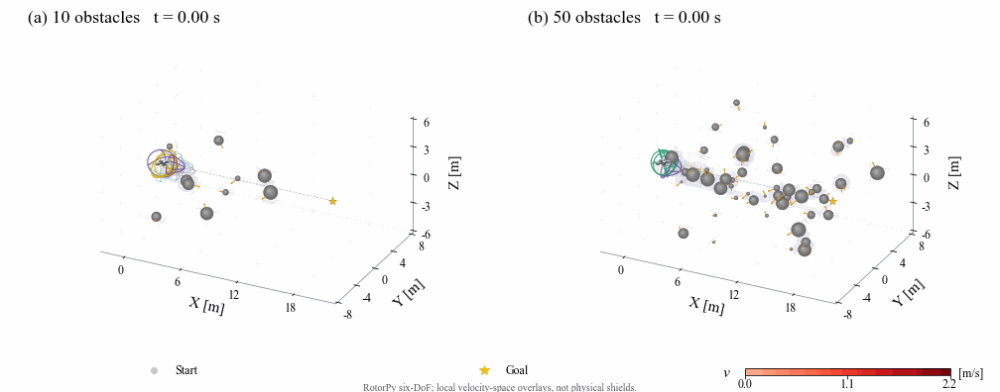

# ③ RotorPy：动力学与执行跟踪

[返回总览](../README.md)

六自由度、姿态与电机动态加入后，QP给出的加速度不一定立即变为实际加速度。本阶段检查实际跟踪、实体间隙、屏障残差、电机限幅和到达后状态。

## 四方法共享四障碍场景







曲线来自控制记录时刻；汇总表中的跟踪峰值还包含细积分区间端点，二者采样口径分别注明。六份正式轨迹与最终汇总的对应关系见[来源绑定表](data/六次轨迹来源绑定.csv)。

| 方法 | 首次到达时间/s |
|---|---:|
| MA-CBF-VO | 9.655 |
| C3BF | 11.100 |
| Park适配 | 12.970 |
| RA-DPCBF | 14.330 |

本例RA没有时间优势。C3BF首次进入目标区域后两秒未稳定，所以首次到达与稳定保持分别记录。

## RA十障碍与五十障碍



这是两个RA验证，不能写成密集场景四方法对比。十障碍与五十障碍的初始化处理也不同，具体见冻结配置与逐次结果。

## 数据与入口

- [六次中文结果](data/六次动力学结果_中文.csv)；[完整机器字段](data/六次动力学结果.csv)。
- [四方法原轨迹与结果](data/)；[冻结控制器](code/frozen_controller/)。
- 正式共享执行入口：[run_quadrotor.py](code/shared_execution_20261030/run_quadrotor.py)。
- 密集场景入口：[run_existing_cases.py](code/shared_execution_20261030/run_existing_cases.py)。

使用独立环境安装`code/constraints.txt`中的约束和RotorPy。上游参考版本为`40b09697a6a1596d404a67f459941d46a39eedd3`。以下示例在`3d-ra-dpcbf/rotorpy`目录执行：

```bash
python code/shared_execution_20261030/run_quadrotor.py --method ra --scene code/four_obstacle_scene.npz
```

该命令会新建仿真结果，已有结果目录将被拒绝覆盖。本次发布未执行该命令，也不把计算周期内的多数成功说成硬实时保证。
